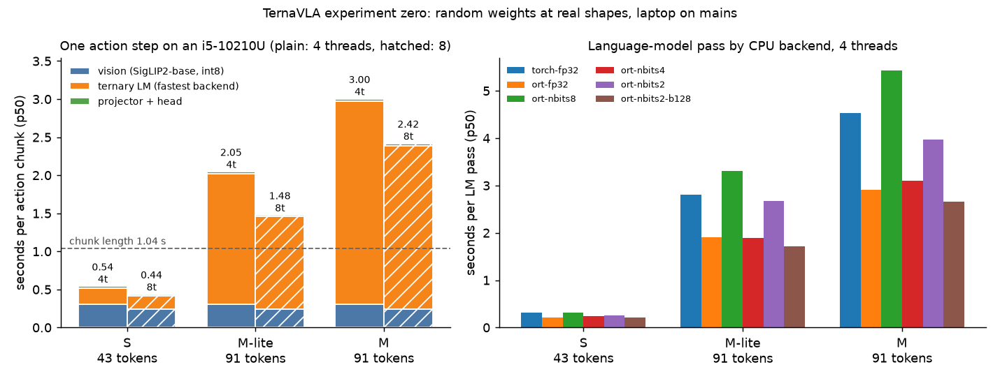

# TernaVLA

**Ternary (1.58-bit) vision-language-action models for edge humanoids, measured on CPUs.**

> **Status: active research.** Nothing is trained yet. The plan is agreed and the CPU cost of
> every model size has been measured (experiment zero). Results are published as they land,
> including the ones that disappoint.

TernaVLA turns a camera image, an instruction and the robot's joint state into one second of
upper-body motion (52 steps × 17 joints at 50 Hz) in a single forward pass of a language model
whose weights are only −1, 0 or +1. The aim is a robot policy that runs on the robot's own CPU,
not on a datacenter GPU.

## Experiment zero: does it fit on a laptop CPU?



Seconds per action chunk on an Intel i5-10210U laptop (4 cores, 15 W, on mains), real layer
shapes, random ternary weights:

| Tier | Backbone | 4 threads | 8 threads | Real-time here? |
|---|---|---|---|---|
| S | BitCPM-CANN-0.5B, Apache-2.0 | 0.54 | **0.44** | yes (chunk = 1.04 s) |
| M-lite | BitCPM-CANN-1B, Apache-2.0 | 2.05 | 1.48 | with 2 s chunks |
| M | BitNet b1.58 2B4T, MIT | 3.00 | 2.42 | no; target is i7 / Jetson |

What we learned:
- **The small tier already runs in real time on a 2019 laptop CPU**, using stock ONNX Runtime.
- **On a CPU without VNNI, 2-bit weights save memory (16× vs fp32), not time**: the 2-bit path is at most about 10 % faster than fp32.
- **The number of tokens is the main lever.** The 13-query action interface is 30 % cheaper than one query per step.
- **Microsoft's bitnet.cpp is the fastest ternary kernel we measured**: the real 2B model processes the 91-token step in 2.10 s on 4 threads, 21 % faster than ONNX Runtime's best 2-bit path.

Full method, tables and caveats: [docs/EXP0.md](docs/EXP0.md).

## The design in one paragraph

A frozen SigLIP2-base encoder (int8) feeds 16 or 64 image tokens to a natively ternary language
model. After the prompt come a joint-state token, a token for actions already committed, and 13
placeholder queries. A small full-precision head turns each query's hidden state into 4 control
steps for 17 joints, trained with an L1 loss. Attention stays causal, so standard runtimes can
execute it. Details and the training plan: [docs/PLAN.md](docs/PLAN.md).

## Prior work and what is new

[BitVLA](https://arxiv.org/abs/2506.07530) showed a ternary VLA reaching 96 % on LIBERO with
GPU-scale training and reports GPU latency only. TernaVLA asks a different question: can a
ternary VLA be adapted on free GPU time and run on the robot's CPU, for a humanoid's joint space?
No CPU latency for any ternary VLA had been published before experiment zero.

## Reproduce

```bash
uv sync                                     # Python 3.12, CPU-only PyTorch + ONNX Runtime 1.31
uv run pytest                               # checks shapes and the 2-bit ternary kernel
uv run python scripts/exp0.py --threads 4 8 # ~10 min; writes results/exp0_*.json
uv run python scripts/exp0_chart.py         # docs/media/exp0_chunk_latency.png
bash scripts/wsl_bitnet_cpp.sh              # (Linux/WSL2) bitnet.cpp I2_S prefill
```

Run on mains power: the script records power, battery and sustained matrix-multiply throughput
at start and end, and marks battery runs unpublishable.

## Roadmap

- [x] Week 0: CPU cost of every tier (this page)
- [x] bitnet.cpp (I2_S) on the real 2B model, under WSL2
- [ ] llama.cpp kernels; i7 and Jetson Orin Nano rows
- [ ] Head-only probe on the 2B tier; small-tier fine-tune; LIBERO-Spatial
- [ ] Simulator data on the reference robot, the Tiangong 2 Pro (17-joint upper body), and the first trained TernaVLA-S / -M
- [ ] Real-robot tests behind a Gemini E head camera (reference robot: Tiangong 2 Pro)

Related: [Humanoid_Perception_for_Edge](https://github.com/shivpratapsinghpanwar/Humanoid_Perception_for_Edge)
(robot, simulator, data engine) and [ternary-vlm](https://github.com/shivpratapsinghpanwar/ternary-vlm)
(the ternary vision-language model behind the 2B tier).

## Licence

Code: Apache-2.0. Model weights we build on keep their own licences (MIT, Apache-2.0).
